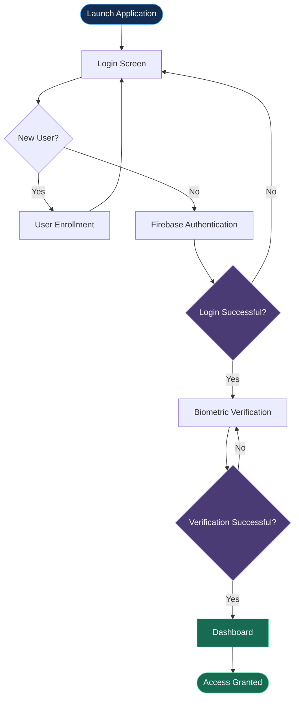

# 🛡️ Secure Defence Network

### Secure Access. Trusted Connections.

A Flutter-based mobile application that combines Firebase Authentication and biometric verification to provide an additional layer of access control.

  
  
  
  

---

## ✨ Key Features

- 🔐 **Firebase Authentication** — Email and password login.
- 👆 **Biometric Verification** — Fingerprint authentication on supported devices.
- 📝 **User Enrollment** — Multi-step registration interface.
- 📱 **Dashboard Access** — Navigation after successful authentication.
- 🎨 **Flutter UI** — A clean, mobile-friendly interface.

## 🔄 Application Workflow

## 🧰 Technologies Used

| Technology | Purpose |
|---|---|
| Flutter | Mobile application development |
| Dart | Application programming |
| Firebase Authentication | Email/password sign-in |
| Firebase Core | Firebase integration |
| `local_auth` | Device biometric verification |
| Android SDK | Android application platform |

## 📸 Project Overview

The application follows a two-stage access flow:

1. **Identity Verification:** Users sign in using their registered email and password.
2. **Biometric Verification:** Users complete a device-supported biometric check before accessing the dashboard.

## 🚀 Future Enhancements

- Dedicated backend server integration.
- Role-based access control.
- Complete user registration and profile management.
- Secure communication features.
- Enhanced security testing and data protection.

## 🔒 Security Notice

This project is a development prototype. Firebase Authentication and biometric verification provide access-control features but do not guarantee complete application or communication security. It is not intended for classified or sensitive operational use.

---

  <b>🛡️ Secure Defence Network</b> 
  Built with Flutter • Focused on Secure Access

